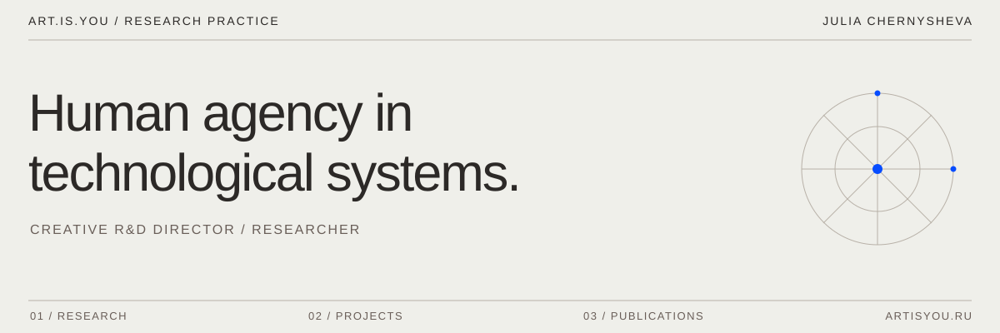

### Julia Chernysheva
**Creative R&D Director / Researcher**

I investigate how technological systems transform human agency, knowledge, culture, and authorship. My practice brings together cultural research, editorial thinking, and experimental digital systems.

---

### Selected research

**01 / [ART.IS.YOU](https://artisyou.ru)**  
An independent research practice at the intersection of technology and culture.

**02 / [BOGOBOT](https://github.com/julchernysheva/bogobot)**  
Artistic research into how non-human intelligence changes the boundaries of human agency.

**03 / [RUSSIAN INTELLECT](https://github.com/julchernysheva/russian-intellect)**  
A research map of people, technologies, and scientific lineages shaping computational culture.

---

**Research territories**  
Human agency · Intelligence · Authorship · Memory · Prediction · Technological systems

[Research](https://artisyou.ru/research/) · [Projects](https://artisyou.ru/projects/) · [Publications](https://artisyou.ru/publications/)
